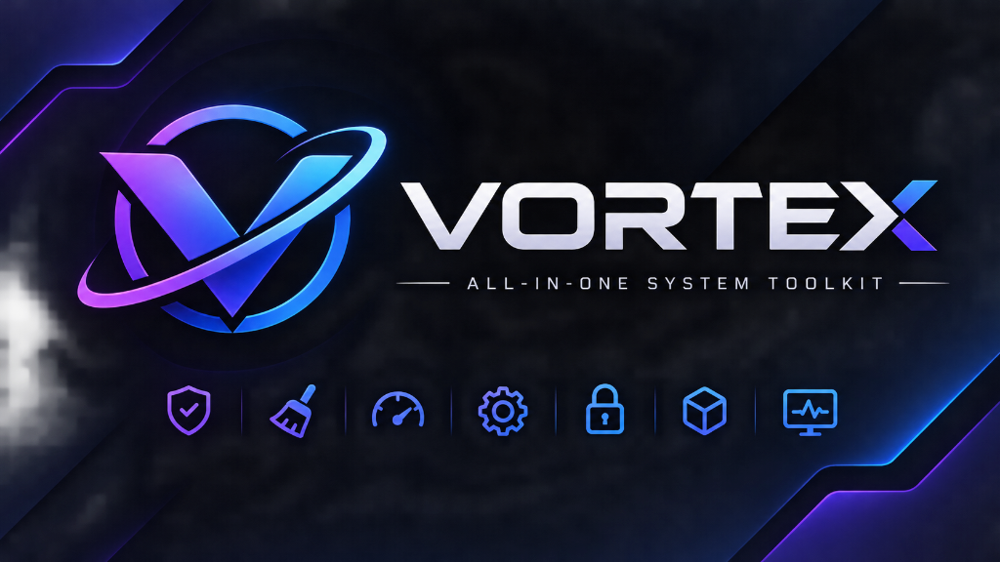

<div align="center">



# ⚡ VORTEX — All-in-One System Toolkit

**VORTEX** es una suite moderna, ligera y portable para la optimización, mantenimiento, limpieza y diagnóstico integral de Windows.

Diseñada con una estética ciberpunk en tonos violeta eléctrico (`#a855f7`) y cian neón (`#00f0ff`), completamente libre de suscripciones, pagos o telemetría forzada.

---

[](#)
[](#)
[](#)
[](#)

</div>

---

## ✨ Características Principales

- 🧹 **Limpiador del Sistema**: Detección y eliminación rápida de archivos temporales, caché de aplicaciones, registros huérfanos y restos de instalaciones.
- ⚡ **Optimización de Rendimiento**: Gestión inteligente del arranque de Windows, servicios en segundo plano y análisis de cuellos de botella.
- 🛡️ **Seguridad y Privacidad Local**: Revisión de configuraciones de privacidad, rastreadores y servicios no deseados, sin enviar tus datos a la nube.
- 💾 **Gestión de Almacenamiento**: Desglose visual del uso del disco, búsqueda de archivos pesados y duplicados.
- 🌐 **Optimización de Red**: Limpieza de caché DNS, restablecimiento de sockets y diagnóstico de conectividad.
- 🎨 **Interfaz Ciberpunk**: Experiencia inmersiva en modo oscuro con acentos violeta y cian, animaciones fluidas y soporte para modo simple o avanzado.
- 🚀 **100% Portable**: No requiere instalación en el sistema. Ejecútalo directamente desde cualquier carpeta o unidad USB.

---

## 🚀 Inicio Rápido

1. Descarga o clona este repositorio:
   ```bash
   git clone https://github.com/Javiiiii11/VORTEX.git
   ```
2. Ejecuta `Vortex.exe` haciendo doble clic.
3. ¡Listo! Todo se ejecuta de forma local en tu máquina.

---

## 🎨 Paleta de Color & Diseño

| Elemento | Color Hex | Muestra |
| :--- | :--- | :--- |
| **Electric Violet** | `#a855f7` |  |
| **Neon Cyan** | `#00f0ff` |  |
| **Cyber Obsidian** | `#070a12` |  |
| **Card Surface** | `#0e1424` |  |

---

## 🔒 Privacidad y Transparencia

- **Cero suscripciones ni micropagos**: Todas las herramientas están completamente desbloqueadas.
- **Sin conexión obligatoria**: Diseñado para funcionar 100% offline.
- **Tus archivos se quedan contigo**: Ningún informe ni análisis sale de tu ordenador.
